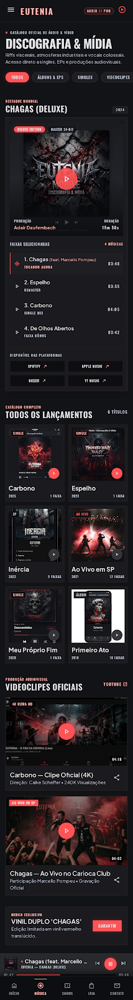

# Experiência mobile v1 Specification

**Approved**: 2026-11-08 - user: "aprovado"

## Problem Statement

A auditoria do site v0 a 390px mostrou que o celular é a experiência mais fraca:
- campos de formulário com menos de 16px fazem o iPhone dar zoom ao toque;
- vários controles têm menos de 44px;
- há textos de 10px em todas as páginas;
- Loja (6,8 mil px), Discografia (7,6 mil px) e Fãs empilham um item por linha;
- os heroes de Contato, Fãs e Loja ocupam a primeira tela inteira.

O público da banda chega principalmente pelo celular (Instagram, YouTube).

## Goals

- [ ] Abaixo de 768px, zero textos com menos de 12px, zero controles com menos de 44×44px e zero campos com menos de 16px nas 7 páginas e na 404.
- [ ] Loja, Discografia e Fãs com 2 itens por linha no celular, encurtando cada página.
- [ ] Primeiro conteúdo de Contato, Fãs e Loja visível na primeira tela de 390×844.
- [ ] Desktop (1280px) idêntico ao site v0.

## Out of Scope

| Feature | Reason |
| ------- | ------ |
| Mudanças no desktop (>= 768px) | Q1: escopo só abaixo de 768px |
| Fãs na barra inferior | Q5: barra mantém 5 itens (AD-014) |
| Conteúdo novo, textos novos além do botão "ENVIAR MENSAGEM" | Q1: escopo = itens 1-6 da auditoria |
| Redesenho do menu (drawer), do cabeçalho ou do player | Fora dos itens da auditoria |
| Página de produto da Loja | Não existe no site estático (AD-005) |
| `git push` e publicação | Só com autorização explícita |

---

## Assumptions & Open Questions

| Assumption / decision | Chosen default | Rationale | Confirmed? |
| --------------------- | -------------- | --------- | ---------- |
| Escopo | Itens 1-6 da auditoria a 390px, só abaixo de 768px | Q1 "Escopo" | y - user: "Recomendacoes" |
| Largura de teste | 390×844 (a mesma do site v0) e 360×800 para as grades de 2 colunas | 390 é a largura das capturas; 360 é o Android mais estreito comum | y - user delegated (Q1) |
| Exceções da área de toque | Links dentro de uma frase (ex.: "Instagram" no estado vazio, "Política de Privacidade" no rótulo de consentimento) e o link "Pular para o conteúdo" ficam de fora; o checkbox conta pela área do seu rótulo | Exceção de links em texto corrido da WCAG 2.5.8; aumentar o link quebraria a frase | y - user delegated (Q6) |
| Texto decorativo | Não há exceção: todo nó de texto visível conta, inclusive rótulos de seção (eyebrows) e badges | Q6 "todo texto" | y - user: "Recomendacoes" |
| Conteúdo do card em 2 colunas | Na Discografia, o card de lançamento fica com capa, tipo · faixas, título, ano e o botão de ouvir, sem a descrição. O card de vídeo fica com miniatura, título em até 2 linhas e ano, sem a linha de crédito. O wallpaper fica com imagem, título, metadados e "DOWNLOAD" | Q3 aceitou cards menores (AD-012); a descrição e o crédito não cabem em ~170px | y - user delegated (Q3) |
| Nome longo em card de 2 colunas | Produto, lançamento e vídeo cortam o nome em 2 linhas com reticências; o nome inteiro fica no `title` | Mantém a altura das linhas da grade | y - user delegated (Q2/Q3) |
| Desktop idêntico | A 1280px, cada página difere da sua foto `*.running.png` do site v0 só por ruído de renderização (≤ 0,01% dos pixels) | Q1 "desktop intacto" | y - user: "Recomendacoes" |
| Nome longo na Loja vs LOJA-07 do site v0 | LOJA-07 (1 linha) vale só a partir de 768px e roda só no projeto desktop; abaixo de 768px vale MOB-10 (2 linhas) | MOB-05 manda manter os testes do v0 e MOB-10 contradiz LOJA-07 no celular | y - Q31, user: "recomendacoes, retome a fase 2 e depois lote 2" |

**Open questions:** none - all resolved or logged above.

---

## User Stories

### P1: Legível e tocável no celular ⭐ MVP

**User Story**: Como fã no celular, quero ler cada texto e acertar cada botão sem dar zoom.

**Why P1**: Hoje o iPhone dá zoom ao tocar nos campos do formulário de contato e de booking, e há controles pequenos em toda página.

**Acceptance Criteria**:

1. WHILE the viewport is narrower than 768px the site SHALL render every visible text node on `/`, `/discografia/`, `/shows/`, `/loja/`, `/fas/`, `/contato/`, `/privacidade/` and the 404 page with a computed font-size of at least 12px (AD-011, departs from `label-sm` in `captures/DESIGN.md`).  <!-- MOB-01 -->
2. WHILE the viewport is narrower than 768px the site SHALL give every visible link, button, tab, `summary`, input, select, textarea and checkbox a hit area of at least 44×44 CSS px on those pages, apart from the exceptions listed in Assumptions.  <!-- MOB-02 -->
3. WHILE the viewport is narrower than 768px the site SHALL render every input, select and textarea with a computed font-size of at least 16px.  <!-- MOB-03 -->
4. WHEN a visitor opens any of those pages at 1280px THEN the site SHALL render it pixel-identical to its site-v0 picture, up to 0.01% differing pixels.  <!-- MOB-04 -->
5. The site SHALL keep every site-v0 check passing, including QUAL-02 (axe), QUAL-03 (focus), QUAL-04 (Lighthouse >= 90) and QUAL-05 (no JavaScript).  <!-- MOB-05 -->

**Independent Test**: A 390px, medir fonte e caixa de cada elemento visível em cada página: nenhum abaixo dos mínimos.

---

### P1: Listas em 2 colunas ⭐ MVP

**User Story**: Como fã no celular, quero ver mais produtos, lançamentos, vídeos e wallpapers por tela, sem rolar páginas de 7 mil pixels.

**Why P1**: Loja, Discografia e Fãs são as páginas mais longas e hoje mostram um item por tela.

**Acceptance Criteria**:

1. WHILE the viewport is narrower than 768px the Loja SHALL lay out the product cards 2 per row (AD-013).  <!-- MOB-06 -->
2. WHILE the viewport is narrower than 768px the product card SHALL show photo, name, price and the "COMPRAR"/"EM BREVE" button and SHALL NOT show the sizes (AD-013).  <!-- MOB-07 -->
3. WHEN a visitor opens `/discografia/` at 390px THEN the site SHALL show the page composed as `captures/mobile-discografia.png`, with the release catalog and the videos 2 per row as listed in Differences from the source (AD-012).  <!-- MOB-08 -->
4. WHILE the viewport is narrower than 768px the Fãs wallpaper grid SHALL lay out the wallpapers 2 per row, each keeping its "DOWNLOAD" link (AD-012).  <!-- MOB-09 -->
5. IF a product, release or video name does not fit in 2 lines of its card THEN the site SHALL cut it at 2 lines with an ellipsis and SHALL keep the full name in the element's `title`.  <!-- MOB-10 -->
6. IF a grid has an odd number of items THEN the site SHALL left-align the last item at the width of one column.  <!-- MOB-11 -->
7. WHEN a visitor uses a Discografia, Loja or wallpaper filter at 390px THEN the site SHALL keep the visible items 2 per row.  <!-- MOB-12 -->

**Independent Test**: A 390px e 360px, abrir Loja, Discografia e Fãs: duas colunas de cards, sem rolagem horizontal da página.

---

### P2: Primeira tela útil

**User Story**: Como produtor ou fã no celular, quero ver o conteúdo da página logo ao abrir, e no Contato chegar ao formulário com um toque.

**Why P2**: O hero de Contato, Fãs e Loja empurra todo o conteúdo para baixo da dobra; o formulário do Contato fica a ~3 mil px.

**Acceptance Criteria**:

1. WHEN a visitor opens `/contato/` at 390×844 THEN the site SHALL show the top of the "DEPARTAMENTOS & CONTATOS DIRETOS" heading above the bottom bar (y < 778px) (AD-014).  <!-- MOB-13 -->
2. WHEN a visitor opens `/fas/` at 390×844 THEN the site SHALL show the top of the "WALLPAPERS OFICIAIS" heading above the bottom bar (y < 778px) (AD-014).  <!-- MOB-14 -->
3. WHEN a visitor opens `/loja/` at 390×844 THEN the site SHALL show the category filter bar above the bottom bar (y < 778px) (AD-014).  <!-- MOB-15 -->
4. WHILE the viewport is narrower than 768px the Contato hero SHALL show an "ENVIAR MENSAGEM" link (AD-014).  <!-- MOB-16 -->
5. WHEN a visitor uses "ENVIAR MENSAGEM" THEN the site SHALL scroll to the message form with its heading fully visible below the sticky header, with or without JavaScript.  <!-- MOB-17 -->
6. WHILE a visitor is on `/fas/` below 768px the bottom bar SHALL show Início · Música · Shows · Loja · Contato with no item marked current (AD-014).  <!-- MOB-18 -->

**Independent Test**: A 390×844, abrir Contato, Fãs e Loja e ver o primeiro conteúdo sem rolar; tocar "ENVIAR MENSAGEM" e cair no formulário.

---

## Edge Cases

- IF a grid has a single item THEN the site SHALL show it at the width of one column, left-aligned (covered by MOB-11).
- WHEN the viewport is 360px wide THEN the site SHALL keep 2 columns per row without horizontal page scroll.  <!-- MOB-19 -->
- IF a product has no photo THEN the 2-column card SHALL keep the same height as its neighbours (placeholder tile, DATA-05).

---

## Requirement Traceability

| Requirement ID | Story | Phase | Status |
| -------------- | ----- | ----- | ------ |
| MOB-01 | P1: Legível e tocável | Tasks | Implementing |
| MOB-02 | P1: Legível e tocável | Tasks | Implementing |
| MOB-03 | P1: Legível e tocável | Tasks | Implementing |
| MOB-04 | P1: Legível e tocável | Tasks | Implementing |
| MOB-05 | P1: Legível e tocável | Tasks | Pending |
| MOB-06 | P1: Listas em 2 colunas | Tasks | Implementing |
| MOB-07 | P1: Listas em 2 colunas | Tasks | Implementing |
| MOB-08 | P1: Listas em 2 colunas | Tasks | Implementing |
| MOB-09 | P1: Listas em 2 colunas | Tasks | Implementing |
| MOB-10 | P1: Listas em 2 colunas | Tasks | Implementing |
| MOB-11 | P1: Listas em 2 colunas | Tasks | Implementing |
| MOB-12 | P1: Listas em 2 colunas | Tasks | Implementing |
| MOB-13 | P2: Primeira tela útil | Tasks | Implementing |
| MOB-14 | P2: Primeira tela útil | Tasks | Pending |
| MOB-15 | P2: Primeira tela útil | Tasks | Pending |
| MOB-16 | P2: Primeira tela útil | Tasks | Implementing |
| MOB-17 | P2: Primeira tela útil | Tasks | Implementing |
| MOB-18 | P2: Primeira tela útil | Tasks | Pending |
| MOB-19 | Edge Cases | Tasks | Implementing |

**Coverage:** 19 total, 0 mapped to tasks, 19 unmapped ⚠️

---

## Differences from the source

| Source shows | Product shows | Confirmed |
| ------------ | ------------- | --------- |
| `DESIGN.md`: `label-sm` 10px | 12px abaixo de 768px | y - AD-011 |
| `DESIGN.md`: campos em `body-md` 15px | 16px abaixo de 768px | y - AD-011 |
| `mobile-discografia.png`: catálogo de lançamentos em 1 coluna, card com descrição | 2 colunas, card sem descrição | y - AD-012 |
| `mobile-discografia.png`: videoclipes em 1 coluna, card com linha de crédito | 2 colunas, miniatura, título em até 2 linhas e ano | y - AD-012 |

## Sources

- Auditoria a 390px do site v0 (2026-11-08) - itens 1-6, aceitos em Q1
-  - binding - tokens do design system Cinematic Heavy (escala de tipo)
-  - binding - Discografia mobile

---

## Success Criteria

- [ ] A auditoria a 390px nas 8 páginas acha 0 textos < 12px, 0 controles < 44×44 fora das exceções e 0 campos < 16px.
- [ ] Loja, Discografia e Fãs ficam pelo menos 35% mais curtas a 390px com os dados reais (hoje 6.774, 7.623 e 4.317 px).
- [ ] As fotos a 1280px não mudam.
