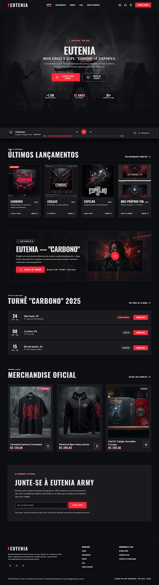
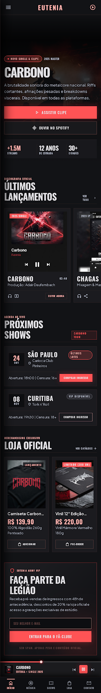
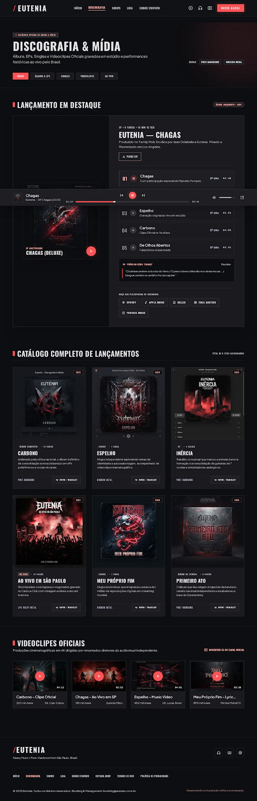
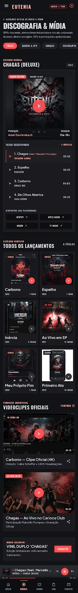
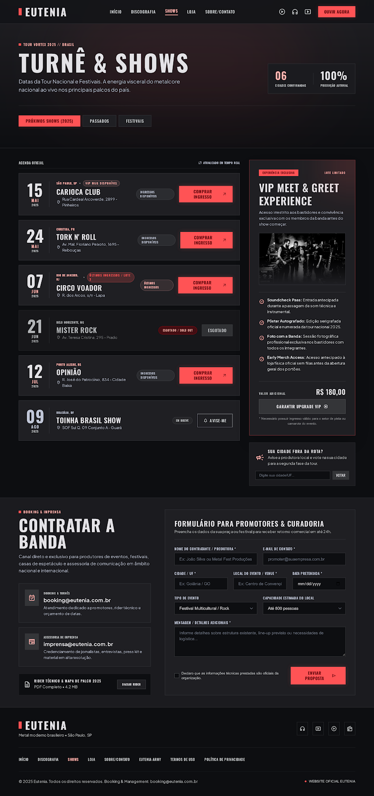
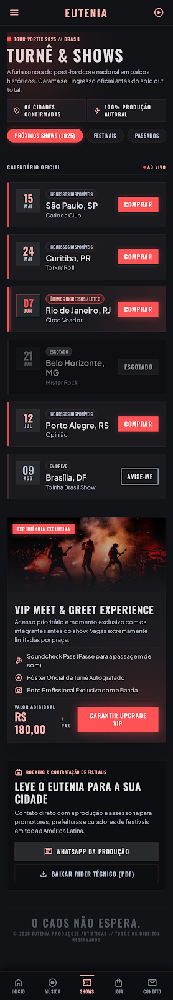
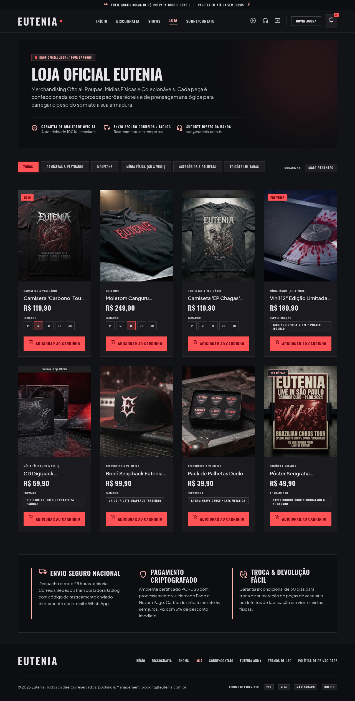
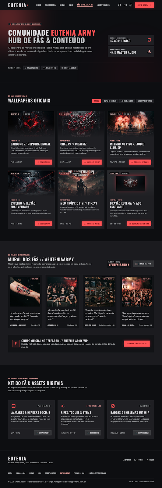
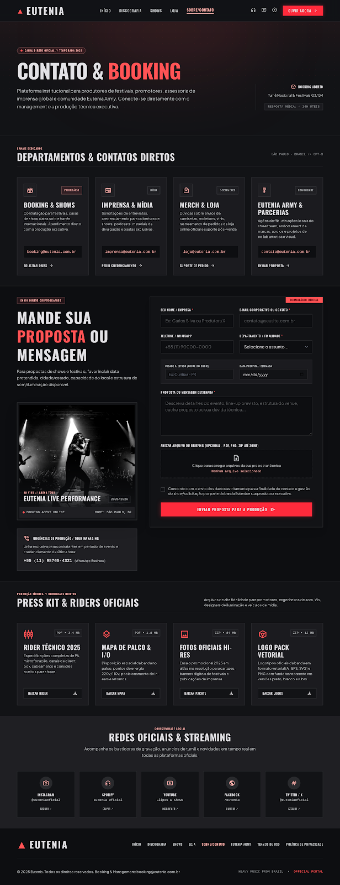

# Site Eutenia v0 Specification

**Approved**: 2026-11-07 - user: "aprovado"

## Problem Statement

O eutenia.net atual é um WordPress com páginas vazias: só título e rodapé. A banda tem um design novo ("Cinematic Heavy", 9 telas do Stitch) e precisa de uma primeira versão real: estática, hospedada no GitHub Pages, com a discografia e os vídeos verdadeiros. O conteúdo fica num formato que a banda edita sem mexer no layout.

## Goals

- [ ] As 6 páginas do design (Início, Discografia, Shows, Loja, Fãs, Contato) e `/privacidade/` publicadas como site estático, fiéis às capturas a 1280px e 390px.
- [ ] 100% do conteúdo editável em arquivos de dados; a discografia (7 lançamentos) e os 11 vídeos são os reais.
- [ ] Zero violações axe `serious`/`critical` e Lighthouse >= 90 em performance e acessibilidade no Início.

## Out of Scope

| Feature | Reason |
| ------- | ------ |
| Carrinho, checkout, pagamento | Site estático (AD-003, AD-005) |
| Backend próprio, banco, login, área de membros | Site estático (AD-001) |
| Player de áudio próprio e persistente entre páginas | Substituído por embed do Spotify (AD-006) |
| Inglês / i18n | Público brasileiro (Q7) |
| Domínio eutenia.net, DNS, migração do WordPress | Q7: sem deploy de domínio na v0 |
| Upload de anexo no formulário de contato | `mailto:` não anexa arquivos; ver Assumptions |
| CMS visual | Edição por arquivos de dados (AD-002) |
| Fotos, wallpapers, produtos e press kit oficiais | A banda troca os placeholders depois (Q6) |
| `git push` e publicação no Pages | Só com autorização explícita (Q7) |

---

## Assumptions & Open Questions

| Assumption / decision | Chosen default | Rationale | Confirmed? |
| --------------------- | -------------- | --------- | ---------- |
| Seções que afirmam fatos (datas de shows, estatísticas, depoimentos do mural, VIP Meet & Greet, membros/downloads, Telegram) | Saem **vazias** na v0, então ficam ocultas pela regra de seção vazia. O arquivo de exemplo de cada uma fica em `content/_exemplos/` | Datas, números e depoimentos inventados enganam fãs reais e configuram depoimentos falsos; produtos e wallpapers com "Em breve"/placeholder não afirmam fatos || y - Q21-Q26, user: "aprovado" |
| Newsletter "Eutenia Army" e "Vote na sua cidade" | Só aparecem quando há endpoint configurado; sem ele, ficam ocultas | `mailto:` não serve como inscrição em lista || y - Q21-Q26, user: "aprovado" |
| Campo "Anexar arquivo ou briefing" do Contato | Removido na v0 | O modo `mailto:` não anexa arquivos e o Formspree grátis também não || y - Q21-Q26, user: "aprovado" |
| "Avise-me" de show sem ingresso à venda | Abre o Instagram oficial | Não existe lista de aviso sem backend || y - Q21-Q26, user: "aprovado" |
| Ordenação da Loja | "Mais recentes" (padrão), "Menor preço", "Maior preço" | O design só desenha o rótulo "Mais recentes" || y - Q21-Q26, user: "aprovado" |
| Filtros sem itens | O botão de um filtro (Discografia, Loja, Wallpapers) sem nenhum item fica oculto | Evita abas que levam a uma lista vazia, como "Ao vivo" sem dado real || y - Q21-Q26, user: "aprovado" |
| Fuso horário dos shows | `America/Sao_Paulo`; um show conta como "próximo" até 23:59 do seu dia | Público brasileiro | y - Q12 |
| Rebuild diário | Workflow agendado 09:00 UTC (06:00 BRT) | Q12 | y |
| Stack | Astro 7, Tailwind 4, TypeScript, Vitest, Playwright, axe, Lighthouse CI | Delegado: "utilize a stack que achar melhor" | y - AD-001 |
| Ícones | Material Symbols Outlined, como nas capturas | Fonte usada pelo design | y |

**Open questions:** none - all resolved or logged above.

---

## User Stories

### P1: Navegação e estrutura comum ⭐ MVP

**User Story**: Como fã, quero um cabeçalho, um rodapé e uma navegação mobile consistentes para chegar a qualquer página em um toque.

**Why P1**: Toda página depende disso.

**Acceptance Criteria**:

1. The site SHALL serve the pages `/`, `/discografia/`, `/shows/`, `/loja/`, `/fas/`, `/contato/` and `/privacidade/` under the configured base path, each with `lang="pt-BR"`, its own `<title>` and meta description.  <!-- NAV-01 -->
2. The header SHALL list, in order, the links Início, Discografia, Shows, Loja, Fãs, Contato, and SHALL mark the current page's link with `aria-current="page"` and the red underline.  <!-- NAV-02 -->
3. WHEN a visitor activates "OUVIR AGORA" in the header THEN the site SHALL open the Spotify artist page in a new tab.  <!-- NAV-03 -->
4. WHEN the viewport is narrower than 768px THEN the site SHALL show the bottom bar Início · Música · Shows · Loja · Contato drawn in `captures/mobile-inicio.png`, with the current item highlighted.  <!-- NAV-04 -->
5. WHEN a mobile visitor activates the menu button THEN the site SHALL open a drawer with all six page links and the social links, and focus its first link.  <!-- NAV-05 -->
6. WHEN the drawer is open and the visitor presses Esc or activates the close button THEN the site SHALL close the drawer and return focus to the menu button.  <!-- NAV-06 -->
7. The footer SHALL show the Eutenia mark, the page links, "Política de Privacidade" linking to `/privacidade/`, the social links (Spotify, Instagram, YouTube, Facebook, X) from the site config, and "© <ano corrente> Eutenia. Todos os direitos reservados." with contato@eutenia.com.br.  <!-- NAV-07 -->
8. The site SHALL contain no internal link or asset reference that resolves to a 404 under the base path.  <!-- NAV-08 -->
9. IF a visitor requests an unknown path THEN the site SHALL show a 404 page in the design system with a link back to Início.  <!-- NAV-09 -->

**Independent Test**: Build, abrir cada rota a 1280px e 390px, clicar em todos os links do menu, do drawer e do rodapé.

---

### P1: Início ⭐ MVP

**User Story**: Como fã, quero ver na primeira tela o lançamento mais recente, ouvi-lo e chegar a lançamentos, clipe, shows e loja.

**Why P1**: É a porta de entrada.

**Acceptance Criteria**:

1. WHEN a visitor opens `/` at 1280px THEN the site SHALL show the page composed as `captures/inicio.png`.  <!-- HOME-01 -->
2. WHEN a visitor opens `/` at 390px THEN the site SHALL show the page composed as `captures/mobile-inicio.png`.  <!-- HOME-02 -->
3. The hero SHALL feature the release marked `destaque` in the discography data (Pandora, 2024), with a primary action that opens its official clip and a secondary action "OUVIR NO SPOTIFY" that opens the release on Spotify.  <!-- HOME-03 -->
4. The site SHALL place a compact Spotify embed of the featured release where the captures draw the player bar.  <!-- HOME-04 -->
5. The "Últimos lançamentos" section SHALL list the 4 most recent releases by release date, newest first, each linking to its entry on `/discografia/`.  <!-- HOME-05 -->
6. The clip section SHALL show the video marked `destaque` (Indestrutível, `Atv4aKAXEmg`) as a thumbnail that loads the YouTube player only when activated.  <!-- HOME-06 -->
7. The shows section SHALL list at most 3 upcoming shows; WHILE there is no upcoming show it SHALL show "Nenhum show anunciado no momento" and links to Instagram and YouTube.  <!-- HOME-07 -->
8. The merch section SHALL list the 3 products marked `destaque`, and SHALL be hidden when no product exists.  <!-- HOME-08 -->
9. WHERE the hero stats data is non-empty the site SHALL show the stats row; otherwise it SHALL omit the row.  <!-- HOME-09 -->

**Independent Test**: Abrir `/`, tocar o embed, abrir o clipe, seguir "Ver discografia completa", "Ver todas as datas" e "Visitar loja completa".

---

### P1: Discografia & Mídia ⭐ MVP

**User Story**: Como fã, quero ver todos os lançamentos com faixas e capas e assistir aos clipes.

**Why P1**: É o conteúdo real que a banda tem.

**Acceptance Criteria**:

1. WHEN a visitor opens `/discografia/` at 1280px THEN the site SHALL show the page composed as `captures/discografia.png`.  <!-- DISC-01 -->
2. WHEN a visitor opens `/discografia/` at 390px THEN the site SHALL show the page composed as `captures/mobile-discografia.png`.  <!-- DISC-02 -->
3. The catalog SHALL list all 7 releases (Pandora, Carbonizar, Cego, Meu Fim (feat. Caio MacBeserra), Espelho, Chymia II, Chymia I), newest first, each with cover, type, year and track count.  <!-- DISC-03 -->
4. The "Lançamento em destaque" block SHALL show the featured release's full tracklist in album order with each track's duration as `m:ss`.  <!-- DISC-04 -->
5. WHEN a visitor activates a filter (Todos, Álbuns & EPs, Singles, Videoclipes) THEN the site SHALL show only the items of that kind and mark the filter as pressed (`aria-pressed="true"`).  <!-- DISC-05 -->
6. WHERE the featured release has lyrics in its data the site SHALL show the "Prévia da letra" block; otherwise it SHALL omit it.  <!-- DISC-06 -->
7. The "Videoclipes oficiais" section SHALL list the 11 videos in the data, the two `[Clipe Oficial]` first, each loading the YouTube player only when activated.  <!-- DISC-07 -->
8. The streaming links block SHALL link to every platform present in the release data and omit absent ones.  <!-- DISC-08 -->
9. WHILE JavaScript is disabled the page SHALL show every release and video, with the filters hidden.  <!-- DISC-09 -->

**Independent Test**: Abrir `/discografia/`, conferir as 7 capas e a tracklist do Pandora, usar cada filtro e abrir um clipe.

---

### P1: Shows & Turnê ⭐ MVP

**User Story**: Como fã ou produtor, quero ver as próximas datas e contratar a banda.

**Why P1**: É a agenda, e o booking gera receita.

**Acceptance Criteria**:

1. WHEN a visitor opens `/shows/` at 1280px THEN the site SHALL show the page composed as `captures/shows.png`.  <!-- SHOW-01 -->
2. WHEN a visitor opens `/shows/` at 390px THEN the site SHALL show the page composed as `captures/mobile-shows.png`.  <!-- SHOW-02 -->
3. The site SHALL classify a show as upcoming when its date is today or later in `America/Sao_Paulo`, and as past otherwise.  <!-- SHOW-03 -->
4. The "Próximos shows" tab SHALL list upcoming shows ordered by date ascending; the "Passados" tab SHALL list past shows ordered by date descending; the "Festivais" tab SHALL list upcoming shows of type `festival`.  <!-- SHOW-04 -->
5. WHEN the page loads in a browser THEN the site SHALL recompute the tabs with the browser's current date, so a show that passed after the build moves to "Passados".  <!-- SHOW-05 -->
6. WHILE a tab has no show it SHALL show "Nenhum show anunciado no momento" with links to Instagram and YouTube.  <!-- SHOW-06 -->
7. Each show row SHALL show day, month, year, city/UF, venue, address, status badge and one action: "COMPRAR INGRESSO" opening the ticket link in a new tab when status is `disponivel` or `ultimos`, a disabled "ESGOTADO" when `esgotado`, and "AVISE-ME" opening the Instagram profile when `em-breve`.  <!-- SHOW-07 -->
8. The "Contratar a banda" form SHALL collect nome do contratante, e-mail, cidade/UF, local, data pretendida, tipo de evento, capacidade, mensagem and consent, and submit per CONT-05 to CONT-07 with subject "Booking - <nome>".  <!-- SHOW-08 -->
9. WHERE the VIP data is non-empty the site SHALL show the "VIP Meet & Greet" card; otherwise it SHALL omit it.  <!-- SHOW-09 -->

**Independent Test**: Com dados de exemplo (um show passado, um hoje, um futuro), conferir cada aba e trocar a data do navegador.

---

### P1: Loja (vitrine) ⭐ MVP

**User Story**: Como fã, quero ver os produtos oficiais, filtrar por categoria e chegar à compra.

**Why P1**: Está no design e na navegação.

**Acceptance Criteria**:

1. WHEN a visitor opens `/loja/` at 1280px THEN the site SHALL show the page composed as `captures/loja.png`, without the departures listed in Differences from the source.  <!-- LOJA-01 -->
2. WHEN a visitor activates a category filter THEN the site SHALL show only that category's products and mark the filter pressed.  <!-- LOJA-02 -->
3. WHEN a visitor chooses "Menor preço" or "Maior preço" in "Organizar" THEN the site SHALL order the visible products by price accordingly; "Mais recentes" SHALL order them by `adicionadoEm` descending.  <!-- LOJA-03 -->
4. WHERE a product has a purchase URL (its own, or the configured store URL) the card SHALL show "COMPRAR" opening it in a new tab; otherwise the card SHALL show a disabled "EM BREVE".  <!-- LOJA-04 -->
5. Each card SHALL show category, name, price formatted as `R$ 119,90`, the badge when present (NOVO, PRÉ-VENDA, edição limitada) and the sizes or specification as non-interactive text.  <!-- LOJA-05 -->
6. WHILE the product list is empty the page SHALL show "Produtos em breve" and a link to Instagram.  <!-- LOJA-06 -->

**Independent Test**: Filtrar por "Moletons", ordenar por "Menor preço", conferir os preços e o "Em breve".

---

### P1: Contato & Booking ⭐ MVP

**User Story**: Como produtor, jornalista ou fã, quero falar com a banda.

**Why P1**: É o único canal comercial.

**Acceptance Criteria**:

1. WHEN a visitor opens `/contato/` at 1280px THEN the site SHALL show the page composed as `captures/contato.png`, without the departures listed in Differences from the source.  <!-- CONT-01 -->
2. The four department cards (Booking & Shows, Imprensa & Mídia, Merch & Loja, Eutenia Army & Parcerias) SHALL show contato@eutenia.com.br as a `mailto:` link with the department in the subject.  <!-- CONT-02 -->
3. The form SHALL contain nome/empresa*, e-mail*, telefone/WhatsApp, departamento*, cidade/estado, data prevista, mensagem* and consent*, where `*` marks required fields.  <!-- CONT-03 -->
4. IF the visitor submits with a required field empty or an invalid e-mail THEN the site SHALL not submit, SHALL show "Campo obrigatório" or "Informe um e-mail válido" under that field, and SHALL focus the first invalid field.  <!-- CONT-04 -->
5. WHERE a form endpoint is configured, WHEN a valid form is submitted THEN the site SHALL POST it to the endpoint and show "Mensagem enviada! Responderemos em breve." in place of the form.  <!-- CONT-05 -->
6. IF the POST fails or times out after 10 s THEN the site SHALL keep the filled form and show "Não foi possível enviar. Escreva para contato@eutenia.com.br.".  <!-- CONT-06 -->
7. WHERE no form endpoint is configured, WHEN a valid form is submitted THEN the site SHALL open a `mailto:contato@eutenia.com.br` link whose subject is "<Departamento> - <nome>" and whose body lists every filled field.  <!-- CONT-07 -->
8. The "Press kit & riders" section SHALL list each downloadable file in the data with its type and size, linking to the file; WHILE the list is empty the section SHALL be omitted.  <!-- CONT-08 -->
9. The "Redes oficiais & streaming" section SHALL link to the five social profiles from the site config.  <!-- CONT-09 -->

**Independent Test**: Enviar vazio, enviar com e-mail inválido, enviar válido sem endpoint (abre o cliente de e-mail) e com um endpoint simulado (200 e 500).

---

### P2: Fãs & Wallpapers

**User Story**: Como fã, quero baixar wallpapers e materiais da banda.

**Why P2**: Engajamento, sem caminho de receita.

**Acceptance Criteria**:

1. WHEN a visitor opens `/fas/` at 1280px THEN the site SHALL show the page composed as `captures/fas.png`, minus sections whose data is empty.  <!-- FAS-01 -->
2. WHEN a visitor activates a wallpaper filter (Todos, Capas de singles, Ao vivo / palco, Logotipos & vetor) THEN the site SHALL show only that category and mark the filter pressed.  <!-- FAS-02 -->
3. Each wallpaper card SHALL show format badge, resolution, title, description, file type and size, and a download link with the `download` attribute pointing at the file.  <!-- FAS-03 -->
4. WHERE the mural, Telegram or kit-do-fã data is non-empty the site SHALL show that section; otherwise it SHALL omit it.  <!-- FAS-04 -->

**Independent Test**: Filtrar wallpapers e baixar um arquivo.

---

### P2: Privacidade

**User Story**: Como visitante que preenche um formulário, quero saber o que é feito com meus dados.

**Acceptance Criteria**:

1. The `/privacidade/` page SHALL state which data the forms collect, the purpose, the contact contato@eutenia.com.br and the last-updated date, rendered from a Markdown file.  <!-- PRIV-01 -->
2. Every form's consent checkbox label SHALL link to `/privacidade/`.  <!-- PRIV-02 -->

---

### P1: Conteúdo editável e qualidade ⭐ MVP

**User Story**: Como membro da banda, quero trocar textos, datas, produtos e imagens editando arquivos, sem quebrar o site.

**Acceptance Criteria**:

1. The site SHALL read releases, videos, shows, products, wallpapers, press files, stats, VIP, mural, social links and contact settings from files under `src/content/` and `src/config/`.  <!-- DATA-01 -->
2. IF a data file violates its schema (missing required field, invalid date, unknown status) THEN the build SHALL fail with a message naming the file and the field.  <!-- DATA-02 -->
3. The repository SHALL contain `PLACEHOLDERS.md` listing every placeholder image and file with its path and what should replace it, and every file under `public/placeholders/` SHALL appear in it.  <!-- DATA-03 -->
4. The site SHALL load no image from `lh3.googleusercontent.com` or any other temporary design URL.  <!-- DATA-04 -->
5. The site SHALL apply the colour, typography, spacing and zero-radius tokens of `captures/DESIGN.md`.  <!-- QUAL-01 -->
6. Every page SHALL have zero axe violations of impact `serious` or `critical` at 1280px and 390px.  <!-- QUAL-02 -->
7. Every interactive control SHALL be reachable and operable by keyboard with a visible focus indicator.  <!-- QUAL-03 -->
8. The Início page SHALL score >= 90 in Lighthouse performance and accessibility (mobile preset).  <!-- QUAL-04 -->
9. WHILE JavaScript is disabled every page SHALL show its content and links; only filters, tabs, sorting and inline video players SHALL be unavailable.  <!-- QUAL-05 -->
10. The repository SHALL contain a GitHub Actions workflow that builds and deploys to GitHub Pages on push to `main` and daily at 09:00 UTC.  <!-- DEPLOY-01 -->
11. The repository SHALL contain a `README.md` explaining how to run locally, edit each data file, configure the form endpoint, the store URL and the base path/domain.  <!-- DEPLOY-02 -->

---

## Edge Cases

- IF a release has no cover image THEN the site SHALL show the Eutenia mark on a surface tile in its place.  <!-- DATA-05 -->
- IF a show's ticket URL is missing while status is `disponivel` THEN the build SHALL fail naming the show.  <!-- DATA-06 -->
- WHEN two shows share a date THEN the site SHALL order them by city name.  <!-- SHOW-10 -->
- IF a product name exceeds the card width THEN the site SHALL truncate it to one line with an ellipsis and expose the full name in its `title`.  <!-- LOJA-07 -->

---

## Requirement Traceability

| Requirement ID | Story | Phase | Status |
| -------------- | ----- | ----- | ------ |
| NAV-01 | P1: Navegação | Design | Pending |
| NAV-02 | P1: Navegação | Design | Pending |
| NAV-03 | P1: Navegação | Design | Pending |
| NAV-04 | P1: Navegação | Design | Pending |
| NAV-05 | P1: Navegação | Design | Pending |
| NAV-06 | P1: Navegação | Design | Pending |
| NAV-07 | P1: Navegação | Design | Pending |
| NAV-08 | P1: Navegação | Design | Pending |
| NAV-09 | P1: Navegação | Design | Implementing |
| HOME-01 | P1: Início | Design | Implementing |
| HOME-02 | P1: Início | Design | Implementing |
| HOME-03 | P1: Início | Design | Implementing |
| HOME-04 | P1: Início | Design | Implementing |
| HOME-05 | P1: Início | Design | Implementing |
| HOME-06 | P1: Início | Design | Implementing |
| HOME-07 | P1: Início | Design | Implementing |
| HOME-08 | P1: Início | Design | Implementing |
| HOME-09 | P1: Início | Design | Implementing |
| DISC-01 | P1: Discografia | Design | Implementing |
| DISC-02 | P1: Discografia | Design | Implementing |
| DISC-03 | P1: Discografia | Design | Implementing |
| DISC-04 | P1: Discografia | Design | Implementing |
| DISC-05 | P1: Discografia | Design | Implementing |
| DISC-06 | P1: Discografia | Design | Implementing |
| DISC-07 | P1: Discografia | Design | Implementing |
| DISC-08 | P1: Discografia | Design | Implementing |
| DISC-09 | P1: Discografia | Design | Implementing |
| SHOW-01 | P1: Shows | Design | Implementing |
| SHOW-02 | P1: Shows | Design | Implementing |
| SHOW-03 | P1: Shows | Design | Implementing |
| SHOW-04 | P1: Shows | Design | Implementing |
| SHOW-05 | P1: Shows | Design | Implementing |
| SHOW-06 | P1: Shows | Design | Implementing |
| SHOW-07 | P1: Shows | Design | Implementing |
| SHOW-08 | P1: Shows | Design | Implementing |
| SHOW-09 | P1: Shows | Design | Implementing |
| SHOW-10 | P1: Shows | Design | Implementing |
| LOJA-01 | P1: Loja | Design | Implementing |
| LOJA-02 | P1: Loja | Design | Implementing |
| LOJA-03 | P1: Loja | Design | Implementing |
| LOJA-04 | P1: Loja | Design | Implementing |
| LOJA-05 | P1: Loja | Design | Implementing |
| LOJA-06 | P1: Loja | Design | Implementing |
| LOJA-07 | P1: Loja | Design | Implementing |
| CONT-01 | P1: Contato | Design | Implementing |
| CONT-02 | P1: Contato | Design | Implementing |
| CONT-03 | P1: Contato | Design | Implementing |
| CONT-04 | P1: Contato | Design | Implementing |
| CONT-05 | P1: Contato | Design | Implementing |
| CONT-06 | P1: Contato | Design | Implementing |
| CONT-07 | P1: Contato | Design | Implementing |
| CONT-08 | P1: Contato | Design | Implementing |
| CONT-09 | P1: Contato | Design | Implementing |
| FAS-01 | P2: Fãs | Design | Implementing |
| FAS-02 | P2: Fãs | Design | Implementing |
| FAS-03 | P2: Fãs | Design | Implementing |
| FAS-04 | P2: Fãs | Design | Implementing |
| PRIV-01 | P2: Privacidade | Design | Implementing |
| PRIV-02 | P2: Privacidade | Design | Implementing |
| DATA-01 | P1: Conteúdo e qualidade | Design | Pending |
| DATA-02 | P1: Conteúdo e qualidade | Design | Pending |
| DATA-03 | P1: Conteúdo e qualidade | Design | Pending |
| DATA-04 | P1: Conteúdo e qualidade | Design | Pending |
| DATA-05 | P1: Conteúdo e qualidade | Design | Pending |
| DATA-06 | P1: Conteúdo e qualidade | Design | Pending |
| QUAL-01 | P1: Conteúdo e qualidade | Design | Pending |
| QUAL-02 | P1: Conteúdo e qualidade | Design | Pending |
| QUAL-03 | P1: Conteúdo e qualidade | Design | Pending |
| QUAL-04 | P1: Conteúdo e qualidade | Design | Pending |
| QUAL-05 | P1: Conteúdo e qualidade | Design | Pending |
| DEPLOY-01 | P1: Conteúdo e qualidade | Design | Pending |
| DEPLOY-02 | P1: Conteúdo e qualidade | Design | Pending |

**Coverage:** 72 total, 0 mapped to tasks, 72 unmapped ⚠️ (until Tasks)

---

## Differences from the source

| Source shows | Product shows | Confirmed |
| ------------ | ------------- | --------- |
| Menu "Sobre/Contato", sem Fãs (todas as capturas) | Início · Discografia · Shows · Loja · Fãs · Contato | y - AD-004 |
| Player customizado em barra / dock fixo (inicio, discografia, mobile-inicio) | Embed compacto do Spotify na mesma posição, não fixo | y - AD-006 |
| "Adicionar ao carrinho", seletor de tamanho clicável (loja) | "Comprar" ou "Em breve"; tamanhos como texto | y - AD-005 |
| Ícone de carrinho com contador, faixa "Frete grátis… 6x sem juros" (loja) | Ausentes | y - AD-005 |
| Bloco "Pagamento criptografado" e "Formas de pagamento: PIX VISA…" (loja) | Ausentes | y - AD-005 |
| E-mails booking@/imprensa@/loja@/contato@eutenia.com.br e telefone +55 (11) 98765-4321 (contato, shows) | contato@eutenia.com.br em todos; sem telefone | y - AD-007 |
| "Termos de uso" no rodapé | "Política de Privacidade" → `/privacidade/` | y - AD-008 |
| Hero e clipe "Carbono" (inicio, mobile-inicio) | Álbum Pandora e clipe Indestrutível | y - AD-009 |
| Seções com dado vazio (estatísticas, mural, VIP, Telegram etc.) | Omitidas até haver dado | y - AD-002 |

## Sources

- `.specs/features/site-v0/context.md` - decisões das rodadas 1-3 e dados reais (Deezer, Spotify, YouTube)
- `.specs/STATE.md` - AD-001 a AD-009
-  - binding - tokens e regras do design system Cinematic Heavy
-  - binding - Início desktop
-  - binding - Início mobile, barra inferior
-  - binding - Discografia & Mídia desktop
-  - binding - Discografia mobile
-  - binding - Turnê & Shows + Contratar a banda desktop
-  - binding - Shows mobile
-  - binding - Loja oficial desktop (1280px)
-  - binding - Comunidade / Wallpapers desktop
-  - binding - Contato & Booking desktop

---

## Success Criteria

- [ ] `npm run build` gera as 7 páginas + 404, e `npm test` passa.
- [ ] Um membro da banda adiciona um show editando um arquivo, e ele aparece em "Próximos shows" após o build.
- [ ] Cada tela, a 1280px e 390px, é aprovada pelo sub-agente de telas contra sua captura.
